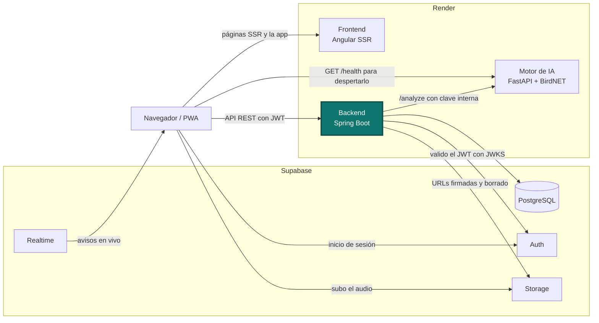

<h1 align="center">AlaSonora · Backend</h1>

<p align="center">
  La API de AlaSonora, la app que identifica aves por su canto y las reúne en un mapa compartido.
  Pruébala en <a href="https://alasonora.com">alasonora.com</a>.
</p>

<p align="center">
  <a href="https://github.com/solartedaniers/AlaSonora-Backend/actions/workflows/ci.yml"></a>
  <a href="https://openjdk.org/projects/jdk/21/"></a>
  <a href="https://spring.io/projects/spring-boot"></a>
  <a href="https://maven.apache.org"></a>
  <a href="https://supabase.com/docs/guides/database/overview"></a>
  <a href="https://docs.docker.com"></a>
</p>

## Contenido

- [El proyecto](#el-proyecto)
- [Arquitectura](#arquitectura)
- [Identificación por foto: mejora futura](#identificación-por-foto-mejora-futura)
- [Tecnologías](#tecnologías)
- [Requisitos previos](#requisitos-previos)
- [Variables de entorno](#variables-de-entorno)
- [Correrlo en local](#correrlo-en-local)
- [Pruebas y build](#pruebas-y-build)
- [Cómo está organizado](#cómo-está-organizado)
- [Endpoints principales](#endpoints-principales)
- [Códigos de error](#códigos-de-error)
- [Borrar detecciones](#borrar-detecciones)
- [Rendimiento de las consultas](#rendimiento-de-las-consultas)
- [Despliegue en Render](#despliegue-en-render)
- [Estructura](#estructura)
- [Problemas comunes](#problemas-comunes)

## El proyecto

AlaSonora tiene tres repositorios:

| Parte | Repositorio | Papel |
|---|---|---|
| Frontend | [AlaSonora-Frontend](https://github.com/solartedaniers/AlaSonora-Frontend) | PWA en Angular con SSR: grabación, espectrograma, mapa y modo offline |
| Backend | **este repositorio** | API REST en Spring Boot: sesiones, base de datos, Storage y orquestación de la IA |
| Motor de IA | [AlaSonora-IA](https://github.com/solartedaniers/AlaSonora-IA) | Microservicio en FastAPI que identifica la especie con BirdNET |

Este repositorio es el backend, el punto central del sistema. Valido los JWT que emite Supabase Auth,
guardo detecciones, perfiles y especies en PostgreSQL (Supabase) y firmo las URLs privadas de Storage.
También orquesto la clasificación: le paso cada audio al motor de IA y enriquezco su respuesta con el
nombre común en español (Wikidata), la foto de la especie (Wikimedia Commons) y las vocalizaciones de
referencia (Xeno-canto). La API pública vive en https://alasonora-backend.onrender.com/api.

## Arquitectura

El recuadro resaltado es este repositorio.



## Identificación por foto: mejora futura

La función principal de AlaSonora es identificar aves por su canto con BirdNET, y está activa. La
identificación por foto la dejé como mejora futura y la apagué a propósito: es una decisión, no un
error. El motor ya tiene el endpoint `/classify-photo`, pero en producción está desactivado con
`PHOTO_CLASSIFICATION_ENABLED=false` en el motor y `photoIdentificationEnabled=false` en el frontend.
Lo hice porque el servidor gratis de Render tiene 512 MB de RAM: el audio usa unos 360 MB y con fotos
el proceso llegaría a unos 750 MB.

## Tecnologías

| Pieza | Versión |
|---|---|
| Java | 21 (`java.version` en `pom.xml`; imágenes `eclipse-temurin:21`) |
| Spring Boot | 4.1.1 (Web MVC, Data JPA, Security, OAuth2 Resource Server, Validation) |
| Maven | 3.9.16, vía el wrapper `./mvnw` |
| PostgreSQL | Supabase, con el driver `org.postgresql` |
| Lombok | la que gestiona Spring Boot 4.1.1 (el `pom.xml` no la fija) |
| JUnit 5 y Logback | los del starter de pruebas |
| H2 | la que gestiona Spring Boot, solo en pruebas (las que cuentan consultas y borran detecciones) |

## Requisitos previos

- **JDK 21**. Lo verificas con `java -version`. Si tienes varias versiones, apunta `JAVA_HOME` al
  JDK 21 antes de usar el wrapper. Con otra versión, `./mvnw -v` lo delata en la línea `Java version`.
- **No necesitas instalar Maven**: `./mvnw` descarga Maven 3.9.16 la primera vez.
- **Un proyecto de Supabase** con base de datos, Auth y Storage (buckets `recordings` y `observer-photos`).
- **El motor de IA corriendo** si quieres clasificar audio ([AlaSonora-IA](https://github.com/solartedaniers/AlaSonora-IA)).
- **Docker**, solo si quieres construir la misma imagen que corre en Render (`docker --version`).

## Variables de entorno

Spring lee el `.env` de la raíz gracias a `spring.config.import` en `application.properties`. El
ejemplo está en `.env.example`. Ninguno de estos valores es real.

**Las que trae `.env.example`:**

| Variable | Para qué sirve | Obligatoria | Ejemplo |
|---|---|---|---|
| `DB_URL` | URL JDBC del pooler de Supabase. Vacía, `contextLoads` se salta | Sí | `jdbc:postgresql://aws-0-<region>.pooler.supabase.com:5432/postgres` |
| `DB_USERNAME` | Usuario de la base | Sí | `postgres.<tu-project-ref>` |
| `DB_PASSWORD` | Contraseña de la base | Sí | `<contraseña de la base>` |
| `SUPABASE_JWKS_URI` | Claves públicas para validar los JWT (ES256) | Sí | `https://<tu-project-ref>.supabase.co/auth/v1/.well-known/jwks.json` |
| `SUPABASE_URL` | Admin API de Supabase, firmado y borrado de objetos de Storage | Sí | `https://<tu-project-ref>.supabase.co` |
| `SUPABASE_SERVICE_ROLE_KEY` | Clave `service_role` (nunca la anon) | Sí | `<service_role key>` |
| `AI_ENGINE_BASE_URL` | URL del motor de IA | No (`http://localhost:8000`) | `https://alasonora-ai-engine.onrender.com` |
| `AI_ENGINE_API_KEY` | Clave interna del motor. Igual a `INTERNAL_API_KEY` de AlaSonora-IA | Sí | `una-clave-larga-local` |
| `XENO_CANTO_API_KEY` | Vocalizaciones de referencia por especie (clave gratuita en xeno-canto.org) | Sí | `<tu clave de Xeno-canto>` |

**Las que tienen valor por defecto en `src/main/resources/application.properties`:**

| Grupo | Variables y valor por defecto |
|---|---|
| Servidor | `PORT=8083` (Render lo inyecta), `MVC_ASYNC_TIMEOUT_MS=30000` |
| Base de datos | `JPA_SHOW_SQL=false` (solo para desarrollo: escribe cada consulta en el log), `JPA_BATCH_FETCH_SIZE=100` |
| Storage | `SUPABASE_RECORDINGS_BUCKET=recordings`, `SUPABASE_OBSERVER_PHOTOS_BUCKET=observer-photos`, `SUPABASE_SIGNED_URL_TTL_SECONDS=120` |
| Grabaciones huérfanas | `ORPHAN_RECORDINGS_CLEANUP_ENABLED=true`, `ORPHAN_RECORDINGS_MIN_AGE=PT24H`, `ORPHAN_RECORDINGS_BATCH_SIZE=100`, `ORPHAN_RECORDINGS_INITIAL_DELAY=PT5M`, `ORPHAN_RECORDINGS_INTERVAL=PT24H` |
| Motor de IA | `AI_ENGINE_TIMEOUT_MS=20000`, `AI_ENGINE_MIN_CONFIDENCE=0.1`, `AI_ENGINE_MAX_RESULTS=3`, `AI_ENGINE_AUDIO_FETCH_TIMEOUT_MS=5000`, `AI_ENGINE_RETRY_ATTEMPTS=1`, `AI_ENGINE_RETRY_BACKOFF_MS=1500`, `AI_ENGINE_ASYNC_SAFETY_MARGIN_MS=1000` |
| Despertar del motor | `AI_ENGINE_WAKE_TIMEOUT_MS=90000`, `AI_ENGINE_WAKE_MAX_DURATION_MS=300000`, `AI_ENGINE_WAKE_RETRY_BACKOFF_MS=5000`, `AI_ENGINE_STATUS_FRESH_MS=600000` |
| Pool de IA | `AI_EXECUTOR_CORE_POOL_SIZE=4`, `AI_EXECUTOR_MAX_POOL_SIZE=8`, `AI_EXECUTOR_QUEUE_CAPACITY=50` |
| Clasificación | `AI_CLASSIFICATION_DISCLAIMER` (aviso que acompaña cada resultado), `AI_PHOTO_MIN_CONFIDENCE=0.3`, `AI_PHOTO_MAX_RESULTS=3` |
| Audio y usuarios | `AUDIO_UPLOAD_MAX_BYTES=10485760`, `USERNAME_MIN_LENGTH=3`, `USERNAME_MAX_LENGTH=20` |
| Notificaciones | `NOTIFICATIONS_HISTORY_SIZE=30`, `NOTIFICATIONS_AREA_MAX_DISTANCE_KM=60` |
| Fuentes externas | `SPECIES_TRANSLATION_ENDPOINT=https://query.wikidata.org/sparql`, `SPECIES_TRANSLATION_USER_AGENT`, `SPECIES_TRANSLATION_TIMEOUT_MS=3000`, `XENO_CANTO_TIMEOUT_MS=5000` |

Los orígenes de CORS no son una variable con nombre propio: los fijo en la propiedad
`app.cors.allowed-origins` (`http://localhost:4200,http://localhost:4000` por defecto). En Render la
sobrescribo con la variable `APP_CORS_ALLOWEDORIGINS` o con el mismo nombre de la propiedad, separados
por coma y sin barra final.

## Correrlo en local

```bash
git clone https://github.com/solartedaniers/AlaSonora-Backend.git
cd AlaSonora-Backend
cp .env.example .env          # completa las credenciales de tu proyecto de Supabase
./mvnw spring-boot:run        # en Windows (cmd o PowerShell): mvnw.cmd spring-boot:run
```

El backend queda en `http://localhost:8083/api`. Para comprobarlo sin sesión, pide una ruta pública:

```bash
curl http://localhost:8083/api/species
```

Al arrancar dejo en el log el host efectivo del motor de IA. Si la URL no sirve, solo aviso: el
backend arranca igual. Para ver cada consulta SQL mientras desarrollo, arranco con `JPA_SHOW_SQL=true`.

### Conectarlo con los otros dos servicios

1. Arranco el motor de IA en `http://localhost:8000` con su `INTERNAL_API_KEY`.
2. En el `.env` de aquí pongo `AI_ENGINE_BASE_URL=http://localhost:8000` y el mismo valor en
   `AI_ENGINE_API_KEY`.
3. Arranco el frontend con `npm start` (`http://localhost:4200`). En desarrollo ya llama a
   `http://localhost:8083/api`, y los orígenes `4200` (ng serve) y `4000` (servidor SSR) ya están en
   CORS por defecto.

## Pruebas y build

```bash
cp .env.example .env
./mvnw test                   # pruebas
./mvnw -DskipTests package    # genera target/backend-0.0.1-SNAPSHOT.jar
```

`contextLoads` levanta el contexto completo contra la base real, así que solo corre si `DB_URL` tiene
valor. Con el `.env.example` aparece como omitida. Las demás no necesitan red ni base real: las del
cliente del motor levantan un servidor HTTP falso en `127.0.0.1`, y las de consultas y borrado usan
H2 en memoria. El workflow `.github/workflows/ci.yml` corre `./mvnw -B test` con Temurin 21 en cada
push a `main` y en cada pull request.

## Cómo está organizado

```
controller  →  service  →  repository (JPA)  →  PostgreSQL (Supabase)
                  │
                  ├── ai/           cliente HTTP del motor, reintentos y despertar
                  ├── translation/  Wikidata, Wikimedia Commons y Xeno-canto
                  ├── storage/      URLs firmadas, borrado de archivos y limpieza de huérfanas
                  └── admin/        Admin API de Supabase (alta y suspensión de usuarios)
```

- **Seguridad**: soy un resource server OAuth2. Valido los JWT de Supabase con su JWKS (ES256) y saco
  el rol del perfil, así puedo usar `hasRole("ADMIN")` en `SecurityConfig`.
- **Clasificación asíncrona**: `POST /api/detections/classify` corre en un pool aparte
  (`aiTaskExecutor`), así una clasificación lenta no ocupa los hilos de Tomcat. Si el pool y su cola
  (`AI_EXECUTOR_*`) están llenos, respondo 503 con `AI_ENGINE_BUSY` en vez de correrla en el hilo de
  Tomcat. Si el motor falla rápido (conexión rechazada, 502, 503, 504), reintento una vez mientras
  quepa en el `spring.mvc.async.request-timeout`.
- **Grabaciones huérfanas**: una tarea diaria borra del bucket `recordings` los audios que se subieron
  pero nunca se guardaron como detección, solo si tienen más de 24 h.
- **Logs del motor**: cada fallo queda con tipo de error, host, status y tiempo, nunca con el cuerpo
  de la respuesta ni con la clave.

### Encendido del motor de IA sin keep-alive

No hay keep-alive, cron ni consultas programadas al motor:

- `GET /api/ai/status` responde al instante con el último estado conocido. Si el motor no está
  listo, `AiEngineWakeUpService` lanza un solo despertar en segundo plano, que repite `GET /health`
  hasta que responde o pasan 5 minutos (`ai.wake.*`).
- Un "listo" vale 10 minutos (`ai.wake.ready-fresh-ms`), menos que los 15 que tarda Render en apagar
  el motor, así que nunca es falso.
- Render no deja que este servicio despierte al motor y responde 429. Lo registro una sola vez por
  ciclo, como INFO (`waiting for the engine to be woken by client traffic`). Lo despierta el
  navegador del usuario con un `GET /health` directo, mientras la app muestra "encendiendo…".

## Endpoints principales

Todas las rutas van bajo `/api`. Salvo las públicas, piden `Authorization: Bearer <JWT de Supabase>`.

| Método y ruta | Acceso | Qué hace |
|---|---|---|
| `GET /species`, `GET /species/{id}` | Público | Catálogo de especies |
| `GET /network-stats` | Público | Estadísticas de la red de observadores |
| `GET /detections?visibility=public` | Público | Detecciones públicas para el mapa |
| `GET /usernames/availability` | Público | Si un nombre de usuario está libre |
| `GET /detections/feed`, `GET /detections/{id}` | Sesión | Feed y detalle de detecciones |
| `GET /detections/mine`, `GET /detections/mine/stats` | Sesión | Mi historial y mis estadísticas |
| `POST /detections/classify` | Sesión | Clasifica un audio con el motor de IA |
| `POST /detections` | Sesión | Guarda una detección confirmada |
| `PUT /detections/{id}/observer-photo` | Sesión | Asocia la foto del observador |
| `DELETE /detections/{id}` | Sesión, solo el dueño | Borra mi detección y sus archivos. Responde 204, o 404 si no existe o no es mía |
| `POST /photo-classifications` | Sesión | Identifica un ave por foto (apagado en producción) |
| `GET /ai/status` | Sesión | Estado del motor al instante. Si no está listo, lo despierta en segundo plano |
| `GET /profile/me`, `PUT /profile/me` | Sesión | Mi perfil |
| `GET /notifications`, `POST /notifications/read` | Sesión | Avisos de la campana |
| `/admin/**` | Rol ADMIN | Usuarios (crear, editar, rol, suspender, activar), historial de un usuario y `DELETE /admin/detections/{id}` |

## Códigos de error

Cada error que el frontend necesita distinguir trae un `errorCode` estable (`ApiErrorCode`) junto al
cuerpo de error de Spring. El texto para el usuario lo pone el i18n del frontend, nunca el backend.

| `errorCode` | Status | Cuándo |
|---|---|---|
| `AUDIO_TOO_LARGE` | 413 | El audio pasa `AUDIO_UPLOAD_MAX_BYTES` |
| `AUDIO_UNSUPPORTED` | 415 | El archivo no es WAV, FLAC ni MP3 |
| `AUDIO_TOO_NOISY`, `NO_BIRD_SIGNAL` | 422 | El motor rechazó el audio por ruido o porque no suena a ave |
| `AUDIO_REJECTED` | 422 | El motor rechazó el audio sin decir el motivo (motor anterior) |
| `NO_SPECIES_IDENTIFIED` | 422 | BirdNET no encontró ninguna especie |
| `AI_ENGINE_UNAVAILABLE` | 502 | El motor está dormido o caído |
| `AI_ENGINE_BUSY` | 503 | El pool de IA y su cola están llenos |
| `USERNAME_INVALID`, `USERNAME_TAKEN` | 400 / 409 | El nombre de usuario no cumple las reglas o ya existe |
| `NO_BIRD_IN_PHOTO`, `PHOTO_UNAVAILABLE` | 422 / 503 | Identificación por foto |
| `DETECTION_NOT_FOUND` | 404 | La detección que quiero borrar no existe o es de otro usuario |

**Traducción de los códigos del motor**: el motor responde `{code, detail}` y `BirdNetHttpClassifier`
lo traduce. `AUDIO_TOO_LARGE` y `AUDIO_UNSUPPORTED` pasan igual; `TOO_NOISY` se vuelve
`AUDIO_TOO_NOISY`, `NO_BIRD_SIGNAL` queda igual, y un 422 sin código queda como `AUDIO_REJECTED`.

## Borrar detecciones

El dueño y el admin comparten el mismo borrado en `DetectionService`:

1. Borro el registro. La cascada de JPA se lleva sus alternativas (`detection_candidates`).
2. Después, `DetectionFileRemover` borra el audio del bucket `recordings` y la foto del bucket
   `observer-photos`. Si Storage falla, la detección ya quedó borrada y solo lo dejo en el log. Si
   quedó un audio, la tarea de grabaciones huérfanas lo limpia.

Si alguien intenta borrar la detección de otro usuario, respondo 404 con `DETECTION_NOT_FOUND`, igual
que si no existiera, para no revelar que el id es real. Como el mapa público y las notificaciones se
calculan desde la tabla `detections`, la detección borrada desaparece de los dos.

## Rendimiento de las consultas

Cada lista de detecciones (mías, feed, públicas y la campana) necesita la especie y las alternativas
de cada detección. Para no hacer una consulta por cada una, activé el batch fetching de Hibernate:
carga especies y alternativas en lotes con `IN (...)`, de `JPA_BATCH_FETCH_SIZE` en
`JPA_BATCH_FETCH_SIZE`. Las alternativas van ordenadas por `id`, el orden en que se guardaron, así que
la respuesta no cambia al cargarlas en lote.

`DetectionQueryCountTest` lo mide con las estadísticas de Hibernate sobre H2. Con 12 detecciones y 4
especies:

| Endpoint | Antes | Ahora |
|---|---|---|
| `GET /api/detections/mine` | 12 consultas | 4 |
| `GET /api/detections/feed` | 15 | 4 |
| `GET /api/detections` | 12 | 4 |
| `GET /api/notifications` | 6 | 5 |

## Despliegue en Render

| Ajuste | Valor |
|---|---|
| Tipo de servicio | Web Service, runtime Docker |
| Root Directory | *(vacío)* |
| Dockerfile Path | `./Dockerfile` |
| Build | Lo hace el `Dockerfile`: `./mvnw clean package -DskipTests -B` sobre `eclipse-temurin:21-jdk` |
| Start | `java -XX:MaxRAMPercentage=75 -jar app.jar` sobre `eclipse-temurin:21-jre` |
| Variables | Las obligatorias de `.env.example`, `AI_ENGINE_BASE_URL` con la URL pública del motor y `app.cors.allowed-origins=https://alasonora.com,https://www.alasonora.com,https://alasonora-frontend.onrender.com` |

Render inyecta `PORT`. `-XX:MaxRAMPercentage=75` existe porque, por defecto, la JVM solo toma el 25 %
de la RAM para el heap, y en una instancia de 512 MB eso no le alcanza a Spring con Hibernate. El
backend no tiene un endpoint de salud dedicado. Si configuras un Health Check Path, usa una ruta
pública como `/api/species`.

## Estructura

```
src/main/java/com/alasonora/backend/
  controller/   Endpoints REST
  service/      Lógica de negocio (detecciones, perfiles, notificaciones, estadísticas)
  ai/           Cliente del motor, traducción de sus códigos, validación de audio, estado y despertar
  config/       Seguridad, CORS y propiedades tipadas
  entity/, repository/, dto/
  exception/    ApiErrorCode, mensajes y el errorCode en el cuerpo de error
  translation/  Nombre común, foto y vocalizaciones de cada especie
  storage/      URLs firmadas, borrado de archivos y limpieza de Storage
  admin/        Admin API de Supabase
  geo/          Zona aproximada de una detección
  async/        Pool de hilos de la IA
src/main/resources/application.properties
Dockerfile
```

## Problemas comunes

| Síntoma | Causa | Solución |
|---|---|---|
| `release version 21 not supported` o el wrapper usa otra Java | `JAVA_HOME` apunta a otro JDK | Apunta `JAVA_HOME` al JDK 21 y revisa con `./mvnw -v` |
| `Could not resolve placeholder 'SUPABASE_JWKS_URI'` (u otra variable) al arrancar | Falta el `.env` o le faltan valores | `cp .env.example .env` y completa las credenciales |
| Todo token responde 401 con `Unsupported algorithm` | Spring solo acepta RS256 por defecto | Ya está `jws-algorithms=ES256`. Revisa que `SUPABASE_JWKS_URI` sea la de tu proyecto |
| El navegador bloquea las peticiones por CORS | El origen del frontend no está permitido | Agrégalo a `app.cors.allowed-origins`, sin barra final |
| Clasificar responde que el motor no está disponible | El motor está apagado o la clave no coincide | Arranca el motor y pon el mismo valor en `AI_ENGINE_API_KEY` e `INTERNAL_API_KEY` |
| Clasificar responde 503 con `AI_ENGINE_BUSY` | Hay más clasificaciones al mismo tiempo de las que caben en el pool y su cola | Espera un momento, o sube `AI_EXECUTOR_*` si la instancia tiene RAM |
| El log muestra `status=429` hacia el motor en Render | Render no deja que el backend lo despierte | Es lo esperado. Lo despierta el navegador del usuario al entrar a la app |
| `contextLoads` aparece como omitida | `DB_URL` está vacía | Normal en CI. Pon credenciales reales si quieres correrla |
| Un archivo queda en Storage tras borrar una detección | Storage falló al borrarlo; el log dice `Could not remove` | El audio lo limpia la tarea de huérfanas; una foto hay que borrarla a mano en Supabase |
